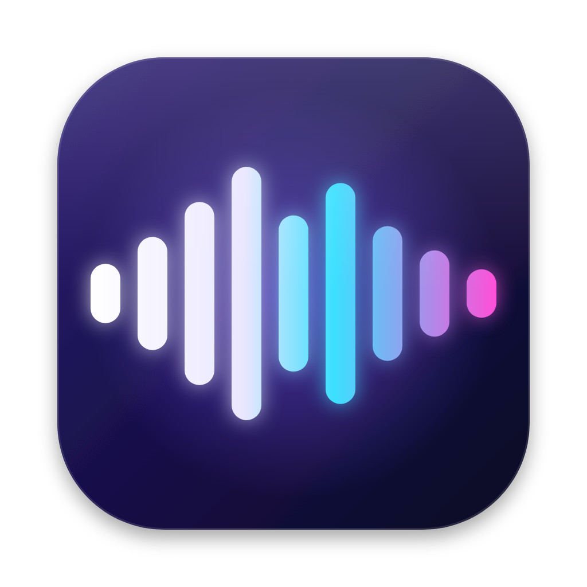

# RVCMac

**Русский** | [English](README.en.md)

[](https://github.com/daniil7890/rvcmac/actions/workflows/build.yml)
[](https://github.com/daniil7890/rvcmac/releases)

Нативный голосовой чейнджер RVC для Mac на Apple Silicon. Голос преобразуется в реальном времени, локально: модели работают через Core ML на Neural Engine и GPU. Во время работы не нужны ни PyTorch, ни браузер, ни сервер.

<p align="center"></p>

## Возможности

- RVC v1/v2 с тоном (f0), 32/40/48 кГц, `.index` и Protect. Модели без тона (nono) пока не поддерживаются.
- Выход на любое устройство: колонки, наушники, [BlackHole](https://github.com/ExistentialAudio/BlackHole) для Discord и OBS.
- Профили голосов и смена голоса на лету, без остановки звука.
- Mute, push-to-talk и глобальные горячие клавиши, управление из строки меню.
- Окно «Диагностика»: полная задержка с разбивкой, время каждого этапа, underrun, CPU и память. Есть бенчмарк и сравнение отчётов.
- Интерфейс на русском и английском.
- Одно скачивание: конвертер моделей приложение ставит само при первом импорте.

### Задержка на практике

MacBook Air M2, «Neural Engine + GPU», выход в BlackHole:

| Блок / контекст / кроссфейд | Полная задержка (p50) | Обработка блока (p50 / p95) |
|---|---|---|
| 150 / 500 / 100 мс | 548 мс | ~45 мс |
| **100 / 500 / 50 мс** | **321 мс** | 50 / 66 мс |

Полная задержка — это путь от звука в микрофоне до звука на выходе. Её складывают алгоритм (блок + кроссфейд), обработка, очередь вывода и задержки устройств. На твоём Mac цифры покажет «Диагностика».

## Установка

1. Скачай `RVCMac-…-arm64.zip` из [Releases](https://github.com/daniil7890/rvcmac/releases), распакуй и перенеси `RVCMac.app` в «Программы».
2. Сборка подписана ad-hoc, без Apple Developer ID, поэтому macOS не даст её открыть. Один раз сними карантин:
   ```bash
   xattr -dr com.apple.quarantine /Applications/RVCMac.app
   ```
3. Открой RVCMac и нажми **Импорт…**. При первом импорте приложение предложит скачать конвертер: Python и библиотеки, около 1 ГБ, один раз. При первой конвертации докачиваются ещё веса ContentVec и FCPE, около 400 МБ.

Ставить Homebrew, Python или клонировать репозиторий не нужно.

**Требования:** Mac на Apple Silicon, macOS 14 или новее. Для Discord и OBS нужен [BlackHole](https://github.com/ExistentialAudio/BlackHole) (`brew install blackhole-2ch`).

## Быстрый старт

1. **Импорт…** → выбери `.pth` или `.safetensors`. `.index` из той же папки подхватится сам, иначе подключи его кнопкой **Index…**.
2. **Задержка:** для начала 100 / 500 / 50 мс. Если модель под эти настройки ещё не собрана, нажми **Собрать**.
3. **Аудио:** вход — микрофон, выход — BlackHole 2ch. В Discord или OBS выбери BlackHole как микрофон.
4. **Старт.** Первый запуск модели занимает до минуты: Neural Engine её компилирует, дальше она берётся из кэша.

## Использование

- **Звук** — тон, порог тишины, громкость, Index и Protect. Всё меняется на лету.
- **Подбор задержки.** Строка внизу показывает время обработки блока. Блок можно уменьшать, пока строка зелёная и не растёт счётчик underrun в «Диагностике». Контекст — это длина окна, которое видят ContentVec и FCPE: чем он больше, тем стабильнее звук, но тем дольше обработка.
- **Без обработки (bypass)** пропускает звук насквозь, чтобы проверить маршрут. **Mute** и **Push-to-talk** глушат выход с короткой рампой, без щелчка.
- **Профили** хранят голос, задержку, вычисления и параметры звука. Между голосами с одинаковой задержкой переключение идёт без остановки: новый голос готовится в фоне и подмешивается кроссфейдом.
- **Горячие клавиши** работают глобально и настраиваются в Настройках (⌘,). По умолчанию старт/стоп ⌥⌘R, mute ⌥⌘M, bypass ⌥⌘B. Push-to-talk и «следующий профиль» назначаются там же.
- **Строка меню** — состояние, mute, bypass и профили. Приложение может оставаться там после закрытия окна.
- **Язык** — как в системе, или вручную в Настройках.

### Диагностика и бенчмарк

Кнопка **Диагностика** внизу главного окна:

- **Live** — полная задержка p50/p95/p99 и её части: конвейер от захвата до вывода, алгоритмическая, устройства. Время этапов: ContentVec, FCPE, index, NSF, синтезатор, SOLA. Underrun, переполнения, CPU, память, тепловое состояние, график. «Сохранить отчёт сессии» пишет JSON и CSV.
- **Бенчмарк** — повторяемый тест на аудиофайле или встроенном сигнале. Холодный старт меряется отдельно, затем прогрев и несколько прогонов в реальном темпе. Результат можно сохранить в WAV и послушать.
- **Сравнение** — два отчёта бок о бок с дельтой. Если настройки отчётов различаются, окно предупреждает.

Методика замеров и аудит аудиотракта описаны в [docs/AUDIT.md](docs/AUDIT.md).

## Как это устроено

```
микрофон ─► Core Audio ─► 16 кГц ─► ContentVec (Core ML, ANE) ─► index (Accelerate) ─┐
                               └──► FCPE (Core ML, GPU, fp32) ─► f0 / NSF-синусоида ──┤
                                                RVC-синтезатор (Core ML, ANE) ◄────────┘
                                                └─► ресемплинг ─► SOLA-кроссфейд ─► выход
```

- **Конвертер** (`converter/convert.py`, Python) переводит RVC-модель, ContentVec и FCPE в `.mlpackage`. Размеры фиксируются под выбранную задержку, чтобы модели шли на Neural Engine. Перед сохранением конвертер сверяет результат Core ML с PyTorch.
- **Приложение** (`app/`, Swift) берёт и выдаёт звук через HAL IOProc. В аудиоколбэках нет локов и аллокаций: обмен идёт через lock-free кольца на C11 atomics (`RVCMacRT`). Инференс работает в отдельном потоке. Поиск по `.index` точный, через `cblas_sgemm`. Склейка блоков — SOLA, как в RVC WebUI и w-okada.
- **Первый запуск.** Скрипты конвертера лежат внутри `RVCMac.app`. Python скачивается из [python-build-standalone](https://github.com/astral-sh/python-build-standalone), его SHA-256 закреплён в сборке и проверяется после скачивания. Библиотеки ставятся в отдельное окружение в папке данных.

## Приватность и безопасность

- Звук обрабатывается только локально. В лог и отчёты аудио не пишется; WAV сохраняется, только если включить это в бенчмарке.
- Из отчётов по умолчанию убираются имена устройств и пути к файлам.
- `.pth` — это pickle, при загрузке он может выполнить код. Поэтому модели открываются в безопасном режиме (`weights_only=True`). Если файл содержит что-то кроме весов, приложение спросит, доверяешь ли ты источнику. По возможности бери `.safetensors`.
- Сеть нужна только для одной установки конвертера и весов ContentVec/FCPE. Голосовые модели из сети автоматически не загружаются.

## Где лежат данные

Голоса, профили, отчёты, лог и окружение конвертера хранятся в `~/Library/Application Support/RVCMac`. Открыть папку: Настройки → «Конвертер моделей» → «Открыть папку данных».

Удалить всё — значит удалить `RVCMac.app` и эту папку. Если голоса лежат в `~/projects/rvcmac` от версии 0.1, а новой папки ещё нет, приложение продолжит брать их оттуда.

## Сборка из исходников

Хватит Command Line Tools (`xcode-select --install`), полный Xcode не нужен.

```bash
git clone https://github.com/daniil7890/rvcmac.git
cd rvcmac
bash scripts/build_app.sh            # локальная сборка: данные лежат в папке репозитория
open RVCMac.app

bash scripts/build_app.sh --release 0.2.0   # как в релизе: данные в Application Support + dist/*.zip
```

Конвертер из Терминала (нужен Homebrew `python@3.12`):

```bash
bash scripts/setup_converter.sh ~/Downloads/voice/model.pth   # окружение + первая модель
venv/bin/python converter/convert.py import --model model.pth [--index added_x.index]
venv/bin/python converter/convert.py config --name model --block-ms 100 --extra-ms 500 --crossfade-ms 50
venv/bin/python converter/convert.py index  --name model --index added_x.index
```

Юнит-тесты (`cd app && swift test`) требуют XCTest. Он есть только в полном Xcode, поэтому на каждый push тесты гоняются в GitHub Actions.

### Структура

| Путь | Что там |
|---|---|
| `app/Sources/RVCMac` | приложение: UI, аудио, движок, диагностика, установка конвертера |
| `app/Sources/RVCMacCore` | логика без платформы: статистика, отчёты, профили, локализация |
| `app/Sources/RVCMacRT` | real-time примитивы на C: кольцевой буфер, seqlock, atomics |
| `app/Tests` | юнит-тесты |
| `converter/` | конвертер моделей в Core ML |
| `scripts/` | сборка, установка конвертера, вспомогательные скрипты CI |
| `docs/AUDIT.md` | аудит аудиотракта и методика замеров |

## Благодарности и лицензии

- Код моделей RVC в `converter/rvc_infer/` взят из [w-okada/voice-changer](https://github.com/w-okada/voice-changer) (форк [deiteris](https://github.com/deiteris/voice-changer)), MIT, см. `converter/rvc_infer/LICENSE-voice-changer`. Изначально он происходит из [RVC-Project](https://github.com/RVC-Project/Retrieval-based-Voice-Conversion-WebUI).
- Веса [ContentVec](https://github.com/auspicious3000/contentvec) и [FCPE](https://github.com/CNChTu/FCPE) скачиваются при конвертации и в репозиторий не входят.
- Python — сборки [python-build-standalone](https://github.com/astral-sh/python-build-standalone).
- Остальной код — MIT (см. `LICENSE`). Написан вместе с Claude (Anthropic).

Используй только те голосовые модели, на которые у тебя есть права, и не выдавай себя за реальных людей.
